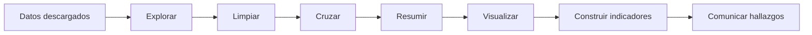
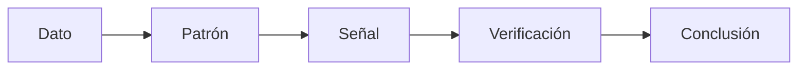
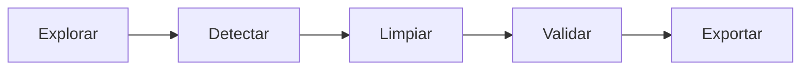
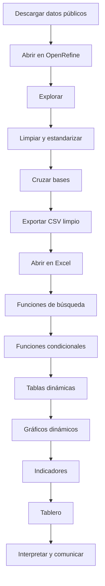

# Sesión 2 — Análisis de datos para la gestión pública

**Curso:** Analítica de Datos e Inteligencia Artificial para la Gestión Pública  
**Entidad:** Contraloría General de Boyacá

## Propósito

En esta sesión se trabajará con datos públicos reales para pasar de una base descargada a información que permita responder preguntas de gestión pública.

El recorrido será:



Se utilizarán principalmente dos herramientas:

- **OpenRefine**, para explorar, depurar, estandarizar y cruzar bases.
- **Excel**, para búsquedas, cálculos condicionales, tablas dinámicas, gráficos dinámicos y un tablero sencillo.

El caso principal será información de **SECOP II**, con énfasis en registros de Boyacá.

## Caso de estudio principal

### SECOP II — Procesos de Contratación

[SECOP II — Procesos de Contratación](https://www.datos.gov.co/Gastos-Gubernamentales/SECOP-II-Procesos-de-Contrataci-n/p6dx-8zbt)

Identificador:

```text
p6dx-8zbt
```

El conjunto permite trabajar con variables como:

```text
Entidad
NIT Entidad
Departamento Entidad
Ciudad Entidad
ID del Proceso
Nombre del Procedimiento
Descripción del Procedimiento
Modalidad de Contratación
Fecha de Publicación
Precio Base
Adjudicado
Proveedor
Valor adjudicado
```

Para la práctica se recomienda utilizar:

```text
Departamento Entidad = Boyacá
```

y una vigencia cerrada, por ejemplo:

```text
2025
```

> [!IMPORTANT]
> El conjunto nacional contiene millones de registros. Para trabajar posteriormente en Excel es preferible filtrar antes de descargar o utilizar el subconjunto preparado para el curso.

### Recurso de apoyo para OpenRefine

[OpenRefine: del dataset sin limpiar a datos confiables](https://shocking-millennium-aa3.notion.site/OpenRefine-del-dataset-sin-limpiar-a-datos-confiables-3f7b5cde3be0818e8eacf1f6251cf7b7)

[Manual oficial de OpenRefine](https://openrefine.org/docs.html)

## Caso complementario — Ficha técnica de SECOP II

La ficha oficial del conjunto permite consultar sus metadatos, cobertura y estructura:

[SECOP II — Procesos de Contratación: ficha del conjunto](https://www.datos.gov.co/Estad-sticas-Nacionales/SECOP-II-Procesos-de-Contrataci-n/p6dx-8zbt/about_data)

La información oficial consultada indica que el conjunto:

```text
registra procesos de compra pública de SECOP II,
sean o no adjudicados;
tiene cobertura nacional;
se actualiza diariamente;
contiene aproximadamente 8,72 millones de filas;
dispone de 59 columnas.
```

La entidad proveedora es la **Agencia Nacional de Contratación Pública — Colombia Compra Eficiente**. Entre los campos documentados se encuentran la entidad, el NIT, el departamento, la ciudad, el ID del proceso, el nombre y la descripción del procedimiento, la fase, las fechas de publicación y el precio base.

> [!IMPORTANT]
> La cantidad de filas y la fecha de actualización pueden cambiar. Antes de analizar, revise la ficha oficial y registre la fecha de consulta, el filtro aplicado y el número de registros utilizado.

Preguntas de verificación:

```text
¿La fila representa un proceso de compra?
¿Qué significa cada campo utilizado?
¿La cobertura es nacional o filtrada a Boyacá?
¿Cuál era la fecha de actualización al consultar?
¿Cuántos registros quedan después de filtrar 2025 y Boyacá?
```

# Análisis exploratorio de datos

## ¿Qué es el análisis exploratorio?

El **análisis exploratorio de datos (EDA)** es el proceso inicial de conocer una base antes de producir conclusiones.

Busca entender:

```text
qué contiene la base,
cómo está estructurada,
qué valores aparecen,
qué información falta,
cómo se distribuyen los datos,
qué comportamientos llaman la atención.
```

## Primeras preguntas

Al recibir un dataset:

```text
¿Cuántas filas tiene?
¿Cuántas columnas?
¿Qué representa cada fila?
¿Qué representa cada columna?
¿Qué variables son numéricas?
¿Qué variables son categóricas?
¿Qué variables son fechas?
¿Qué valores faltan?
¿Existen duplicados?
¿Qué categorías aparecen?
¿Cuáles son los valores mínimos y máximos?
¿Existen valores que parecen inusuales?
```

## Unidad de observación

Antes de analizar debe identificarse qué representa una fila.

En SECOP II — Procesos de Contratación:

```text
Una fila = un proceso de contratación
```

Por tanto:

```text
Número de filas
```

no necesariamente significa:

```text
Número de contratos
```

## Variables categóricas

Ejemplos:

```text
Departamento
Municipio
Modalidad de contratación
Fase
Estado
Entidad
Proveedor
```

Preguntas:

```text
¿Qué modalidades aparecen?
¿Cuál aparece con mayor frecuencia?
¿Cuántas entidades diferentes existen?
¿Qué municipios aparecen?
¿Existen valores como "No Definido"?
```

## Variables numéricas

Ejemplos:

```text
Precio base
Valor adjudicado
Duración
Número de respuestas
```

Preguntas:

```text
¿Cuál es el valor mínimo?
¿Cuál es el máximo?
¿Cuál es el promedio?
¿Existen valores extremadamente altos?
¿Existen ceros?
¿Existen valores negativos?
```

## Variables de fecha

Ejemplos:

```text
Fecha de publicación
Fecha de última publicación
Fecha de adjudicación
```

Permiten responder:

```text
¿Cuántos procesos se publicaron por mes?
¿Existe algún mes con mayor actividad?
¿Cómo cambia el comportamiento durante el año?
```

## Exploración inicial con OpenRefine

### Crear el proyecto

```text
OpenRefine
↓
Create Project
↓
This Computer
↓
Seleccionar CSV
↓
Next
↓
Create Project
```

OpenRefine trabaja sobre una copia dentro del proyecto y no modifica directamente el archivo original.

### Faceta de texto

```text
Columna
↓
Facet
↓
Text facet
```

Útil en:

```text
Modalidad de Contratación
Ciudad Entidad
Departamento Entidad
Fase
Proveedor
```

Permite observar categorías, frecuencia, variantes y valores poco frecuentes.

### Faceta numérica

```text
Columna
↓
Facet
↓
Numeric facet
```

Útil para:

```text
Precio Base
Valor adjudicado
```

Permite observar mínimos, máximos, distribución y valores no numéricos.

### Faceta por blancos

```text
Columna
↓
Facet
↓
Customized facets
↓
Facet by blank
```

```text
true  → vacío
false → contiene información
```

### Faceta de duplicados

Si una variable debería actuar como identificador:

```text
ID del Proceso
```

puede revisarse mediante:

```text
Columna
↓
Facet
↓
Customized facets
↓
Duplicates facet
```

> [!IMPORTANT]
> Encontrar un identificador repetido no significa que deba eliminarse automáticamente. Primero debe comprenderse por qué está repetido.

## Taller — Exploración de SECOP II

Responda:

```text
Número de filas:
Número de columnas:
Unidad de observación:
```

Luego:

```text
¿Cuántas modalidades diferentes aparecen?
¿Cuántas entidades diferentes aparecen?
¿Cuántos municipios aparecen?
¿Qué columnas presentan valores vacíos?
¿Qué columnas contienen "No Definido"?
Precio base mínimo:
Precio base máximo:
¿Existen ceros?
Fecha mínima:
Fecha máxima:
¿Todos los registros pertenecen al periodo esperado?
```

# Identificación de patrones, tendencias y anomalías

## Patrón

Un patrón es un comportamiento que aparece repetidamente.

Ejemplos:

```text
Una modalidad utilizada con frecuencia.
Un proveedor que aparece repetidamente.
Una entidad con actividad contractual constante.
Procesos concentrados en determinados meses.
```

## Tendencia

Una tendencia describe un comportamiento a través del tiempo.

```text
Enero     120 procesos
Febrero   135 procesos
Marzo     160 procesos
Abril     190 procesos
```

Las tendencias suelen requerir:

```text
fecha + conteo
```

o:

```text
fecha + valor
```

## Anomalía

Una anomalía es un dato o comportamiento que se diferencia del resto.

Ejemplos:

```text
Un proceso con un valor muy superior a los demás.
Una fecha fuera del periodo esperado.
Un registro sin municipio.
Un proveedor con un número inusualmente alto de procesos.
Una categoría que aparece solamente una vez.
```

> [!IMPORTANT]
> Una anomalía es una **señal para revisar**, no una prueba de irregularidad.



# Limpieza de datos con OpenRefine



## Espacios innecesarios

```text
Tunja
Tunja 
 Tunja
```

Ruta:

```text
Edit cells
↓
Common transforms
↓
Trim leading and trailing whitespace
```

## Espacios repetidos

```text
ALCALDIA  MUNICIPAL
```

Ruta:

```text
Edit cells
↓
Common transforms
↓
Collapse consecutive whitespace
```

## Mayúsculas y minúsculas

```text
BOYACA
Boyaca
boyaca
```

Opciones:

```text
To uppercase
To lowercase
To titlecase
```

## Clustering

Puede ayudar a localizar variantes como:

```text
ALCALDIA MUNICIPAL DE TUNJA
ALCALDÍA MUNICIPAL DE TUNJA
ALCALDIA  MUNICIPAL DE TUNJA
```

Ruta:

```text
Text facet
↓
Cluster
```

Puede comenzarse con:

```text
Key collision
→ fingerprint
```

> [!CAUTION]
> OpenRefine propone agrupaciones. La decisión de fusionarlas debe ser revisada por una persona.

## Conversión de tipos

```text
"350000000"
```

puede necesitar convertirse en número.

```text
Edit cells
↓
Common transforms
↓
To number
```

También pueden transformarse fechas mediante:

```text
To date
```

Siempre debe verificarse cuántos valores fueron transformados correctamente.

## Datos faltantes

Podemos encontrar:

```text
vacío
No Definido
No Aplica
NULL
0
```

No significan necesariamente lo mismo.

Antes de reemplazar:

```text
¿Está realmente ausente?
¿No aplica?
¿La fuente no lo reportó?
¿Es un valor válido?
```

## Duplicados

Los duplicados deben revisarse mediante una llave adecuada.

Ejemplo:

```text
ID del Proceso
```

No es recomendable eliminar filas solamente porque entidad, proveedor y valor sean iguales.

## Taller — Limpieza

- [ ] Revisar espacios al inicio y al final.
- [ ] Normalizar espacios repetidos.
- [ ] Revisar categorías mediante Text Facet.
- [ ] Utilizar clustering en una variable de texto.
- [ ] Identificar celdas vacías.
- [ ] Revisar tipos de datos.
- [ ] Revisar posibles duplicados por identificador.
- [ ] Verificar fechas.
- [ ] Conservar registro de las transformaciones.

## Historial

OpenRefine registra las operaciones en:

```text
Undo / Redo
```

Esto permite revisar, deshacer y reutilizar transformaciones.

# Cruce y depuración de bases de datos

## ¿Qué significa cruzar bases?

Cruzar datos consiste en relacionar dos tablas mediante un campo común.

### Tabla A — Procesos

| NIT proveedor | Proceso | Valor |
|---|---|---:|
| 800123456 | P-001 | 45000000 |

### Tabla B — Proveedores

| NIT | Nombre | Departamento |
|---|---|---|
| 800123456 | Constructor XYZ | Boyacá |

Llave:

```text
NIT
```

Resultado:

| NIT | Proceso | Valor | Nombre | Departamento |
|---|---|---:|---|---|
| 800123456 | P-001 | 45000000 | Constructor XYZ | Boyacá |

## Llaves posibles

```text
NIT
Código DIVIPOLA
ID del proceso
Código de proyecto
Código de entidad
```

Una buena llave debe ser estable, consistente y comparable entre las bases.

## Cruce con OpenRefine

OpenRefine permite consultar otro proyecto mediante:

```text
cross()
```

Flujo:

```text
Importar base A
↓
Importar base B
↓
Identificar llave
↓
Limpiar llave en ambas
↓
Agregar columna desde el proyecto relacionado
```

Ejemplo conceptual:

```text
cell.cross("Proveedores","NIT").cells["Nombre"].value[0]
```

Antes del cruce:

```text
¿El NIT está como texto en ambas bases?
¿Tiene guiones en una base y en otra no?
¿Existen espacios?
¿Existen valores vacíos?
¿La llave se repite?
¿Puede tener múltiples coincidencias?
```

## Sin coincidencia

Una no coincidencia puede significar:

- problema de formato;
- dato faltante;
- base incompleta;
- registro no incluido en la segunda fuente;
- llave incorrecta.

No debe asumirse automáticamente que existe un error.

# De OpenRefine a Excel

Cuando el conjunto esté suficientemente depurado:

```text
Export
↓
Comma-separated value (.csv)
```

Ejemplo:

```text
secop_boyaca_2025_limpio.csv
```


# Funciones de búsqueda en Excel

Las funciones de búsqueda permiten traer información desde otra tabla utilizando una llave común.

## BUSCARV

```excel
=BUSCARV(valor_buscado; rango_tabla; núm_col; FALSO)
```

Ejemplo:

```excel
=BUSCARV(B2; Proveedores!$A$2:$C$500; 2; FALSO)
```

Características:

- búsqueda vertical;
- la llave debe estar en la primera columna del rango;
- para identificadores se recomienda coincidencia exacta;
- si existen duplicados devuelve la primera coincidencia.

## BUSCARH

```excel
=BUSCARH(valor_buscado; rango_tabla; núm_fila; FALSO)
```

Es útil cuando la información está organizada horizontalmente.

## BUSCARX

```excel
=BUSCARX(valor_buscado; rango_buscar; rango_devolver; "No registrado")
```

Ventajas:

- busca en cualquier dirección;
- no requiere contar columnas;
- permite definir el resultado cuando no encuentra coincidencia;
- puede devolver información de columnas ubicadas a ambos lados de la llave.

| Función | Dirección | Uso |
|---|---|---|
| BUSCARV | Vertical | Compatible con muchas versiones |
| BUSCARH | Horizontal | Uso puntual |
| BUSCARX | Cualquier dirección | Alternativa moderna y flexible |

# Funciones condicionales

## CONTAR.SI

```excel
=CONTAR.SI(rango; criterio)
```

Ejemplo:

```excel
=CONTAR.SI(B:B; "Mínima cuantía")
```

## SUMAR.SI

```excel
=SUMAR.SI(rango_criterio; criterio; rango_suma)
```

Ejemplo:

```excel
=SUMAR.SI(B:B; "Mínima cuantía"; F:F)
```

## CONTAR.SI.CONJUNTO

```excel
=CONTAR.SI.CONJUNTO(rango1; criterio1; rango2; criterio2)
```

Ejemplo conceptual:

```text
Modalidad = Mínima cuantía
Y
Precio base > $50 millones
```

## SUMAR.SI.CONJUNTO

```excel
=SUMAR.SI.CONJUNTO(rango_suma; rango1; criterio1; rango2; criterio2)
```

## SI

```excel
=SI(F2>500000000;"Alto";SI(F2>100000000;"Medio";"Bajo"))
```

Los rangos anteriores son solo una clasificación pedagógica. No representan una escala oficial de riesgo.

## SIERROR

```excel
=SIERROR(BUSCARV(A2;Proveedores!A:B;2;FALSO);"Sin registro")
```

## Y / O

```excel
=SI(Y(F2>50000000;B2="Contratación directa");"Revisar";"")
```

`Revisar` representa una señal para observar el registro, no una conclusión de irregularidad.

# Taller — Estadísticas de contratación

Construya:

| Modalidad | Número de procesos | Valor total | % del total |
|---|---:|---:|---:|
| | | | |
| | | | |
| | | | |

Utilice:

```text
CONTAR.SI
SUMAR.SI
CONTAR.SI.CONJUNTO
SUMAR.SI.CONJUNTO
```

# Tablas dinámicas

## ¿Qué son?

Una tabla dinámica reorganiza una base plana para responder preguntas sin escribir una fórmula distinta para cada categoría.

Datos:

| Entidad | Modalidad | Proveedor | Valor |
|---|---|---|---:|
| Entidad A | Mínima cuantía | Proveedor X | 45000000 |
| Entidad A | Directa | Proveedor Y | 30000000 |
| Entidad B | Directa | Proveedor Z | 120000000 |

Resumen:

| Entidad | Directa | Mínima cuantía | Total |
|---|---:|---:|---:|
| Entidad A | 30000000 | 45000000 | 75000000 |
| Entidad B | 120000000 | 0 | 120000000 |

## Preparar datos

La base debe tener:

- encabezados;
- una fila por registro;
- sin filas completamente vacías;
- sin celdas combinadas.

Se recomienda:

```text
Ctrl + T
```

## Insertar

```text
Seleccionar una celda
↓
Insertar
↓
Tabla dinámica
↓
Nueva hoja
```

Zonas:

```text
FILAS
COLUMNAS
VALORES
FILTROS
```

Ejemplo:

```text
FILAS      → Modalidad
VALORES    → Conteo de ID del Proceso
VALORES    → Suma de Precio Base
FILTROS    → Entidad
```

# Preguntas con tablas dinámicas

## Procesos por modalidad

```text
Fila  → Modalidad
Valor → Conteo de ID
```

## Valor por modalidad

```text
Fila  → Modalidad
Valor → Suma de Precio Base
```

## Distribución por mes

```text
Fila    → Fecha de publicación
Agrupar → Mes
Valor   → Conteo de procesos
```

## Proveedores con mayor valor

```text
Fila   → Proveedor
Valor  → Suma
Filtro → Top 10
```

## Participación porcentual

```text
Mostrar valores como
↓
% del total general
```

# Agrupaciones y segmentadores

Las fechas pueden agruparse por:

```text
Mes
Trimestre
Año
```

También pueden crearse rangos numéricos de trabajo.

Los **segmentadores** permiten filtrar visualmente:

```text
Insertar
↓
Segmentación de datos
```

Ejemplos:

```text
Entidad
Modalidad
Año
Municipio
```

# Taller — Análisis multidimensional

Construya tablas dinámicas para responder:

1. ¿Cuántos procesos existen por modalidad?
2. ¿Qué valor total concentra cada modalidad?
3. ¿Cómo se distribuyen los procesos por mes?
4. ¿Cuáles son los proveedores con mayor valor acumulado?
5. ¿Qué porcentaje del valor total representa cada entidad o modalidad?

> [!IMPORTANT]
> Estas preguntas permiten describir y priorizar información. No constituyen por sí solas una conclusión fiscal.

# Gráficos dinámicos

Un gráfico dinámico está vinculado a una tabla dinámica.

Cuando cambian filtros o segmentadores, el gráfico se actualiza.

```text
Seleccionar tabla dinámica
↓
Insertar
↓
Gráfico dinámico
↓
Seleccionar tipo
```

## ¿Qué gráfico utilizar?

### Barras o columnas

Para comparar categorías:

```text
Valor por modalidad
Procesos por entidad
Top proveedores
```

### Línea

Para tendencias:

```text
Procesos publicados por mes
```

### Circular

Para pocas categorías que formen un total.

### Barras apiladas

Para comparar composición.

### Dispersión

Para estudiar relación entre dos variables numéricas:

```text
Precio base
vs.
Valor adjudicado
```

# Diseñar para comunicar

Evite:

```text
Gráfico 1
```

Prefiera un título que comunique el resultado observado.

Todo gráfico debería indicar:

```text
Título
Unidad
Periodo
Fuente
```

Ejemplo:

```text
Fuente: SECOP II
Cobertura: Boyacá
Periodo: 2025
```

# Construcción de indicadores

Un indicador debe tener:

```text
Nombre
Pregunta
Fórmula
Fuente
Periodo
Unidad
Interpretación
Limitación
```

## Participación por modalidad

\[
	ext{Participación} =
rac{	ext{Procesos de una modalidad}}
{	ext{Total de procesos}}
	imes 100
\]

## Participación en valor

\[
	ext{Participación en valor} =
rac{	ext{Valor de una modalidad}}
{	ext{Valor total}}
	imes 100
\]

## Completitud

\[
	ext{Completitud} =
rac{	ext{Registros con dato informado}}
{	ext{Total de registros}}
	imes 100
\]

## Variación mensual

\[
	ext{Variación} =
rac{	ext{Valor del mes actual} - 	ext{Valor del mes anterior}}
{	ext{Valor del mes anterior}}
	imes 100
\]

# Taller — Construya un indicador

| Campo | Respuesta |
|---|---|
| Nombre | |
| Pregunta | |
| Numerador | |
| Denominador | |
| Fórmula | |
| Fuente | |
| Periodo | |
| Resultado | |
| Interpretación | |
| ¿Qué no permite concluir? | |

# Casos aplicados a contratación, presupuesto y ejecución de recursos

## Contratación

Preguntas:

```text
¿Cuántos procesos se publican por modalidad?
¿Qué entidades concentran mayor valor?
¿Cómo cambia el número de procesos por mes?
¿Qué proveedores aparecen con mayor frecuencia?
¿Qué registros presentan valores que requieren revisión?
```

Fuente:

[SECOP II — Procesos de Contratación](https://www.datos.gov.co/Gastos-Gubernamentales/SECOP-II-Procesos-de-Contrataci-n/p6dx-8zbt)

## Presupuesto

Si una base contiene:

```text
Apropiación inicial
Apropiación definitiva
Compromisos
Obligaciones
Pagos
```

pueden construirse:

### Compromisos frente a apropiación

\[
rac{	ext{Compromisos}}
{	ext{Apropiación definitiva}}
	imes 100
\]

### Obligaciones frente a compromisos

\[
rac{	ext{Obligaciones}}
{	ext{Compromisos}}
	imes 100
\]

### Pagos frente a obligaciones

\[
rac{	ext{Pagos}}
{	ext{Obligaciones}}
	imes 100
\]

## Ejecución de recursos


No deben utilizarse:

```text
ejecutado
comprometido
obligado
pagado
```

como si fueran equivalentes.

# Caso complementario — Lectura de la ficha oficial de SECOP II

La ficha del conjunto permite practicar la lectura crítica de metadatos antes de comenzar el análisis:

[Consultar la ficha oficial de SECOP II](https://www.datos.gov.co/Estad-sticas-Nacionales/SECOP-II-Procesos-de-Contrataci-n/p6dx-8zbt/about_data)

Verifique en la ficha:

```text
entidad responsable de los datos
descripción del conjunto
cobertura geográfica
frecuencia de actualización
número de filas y columnas
nombre y tipo de las variables
fecha de la última actualización
```

Preguntas:

```text
¿Qué procesos incluye el conjunto?
¿Qué diferencia existe entre un proceso y un contrato?
¿Qué campos permiten filtrar Boyacá y 2025?
¿Qué campo puede utilizarse como identificador del proceso?
¿Qué limitaciones deben registrarse antes de presentar un resultado?
```

Este caso se utiliza para practicar la documentación y la interpretación responsable de la fuente antes de construir indicadores.

# Tablero final en Excel

Cree una hoja:

```text
Tablero
```

Incluya:

## Indicadores de cabecera

Seleccione entre:

```text
Total de procesos
Valor total
Proveedores únicos
Modalidad con mayor número de procesos
```

## Gráfico por modalidad

```text
Barras horizontales
```

## Gráfico temporal

```text
Línea mensual
```

## Top de proveedores

```text
Top 10 por valor
```

o:

```text
Top 10 por número de procesos
```

## Segmentadores

```text
Modalidad
Entidad
Municipio
Año
```

# Presentación del resultado

Cada grupo debe explicar:

```text
1. Qué pregunta quiso responder.
2. Qué limpieza realizó.
3. Qué cruce realizó, si aplica.
4. Qué tabla dinámica utilizó.
5. Qué gráfico construyó.
6. Qué indicador calculó.
7. Qué patrón o señal encontró.
8. Qué información adicional necesitaría para verificarla.
```

# Dato, hallazgo y acción

## Dato

```text
35 % del valor analizado corresponde a una modalidad determinada.
```

## Hallazgo analítico

```text
La modalidad presenta la mayor participación dentro del conjunto analizado.
```

## Acción de análisis

```text
Revisar el contexto, los procesos asociados y la documentación antes de formular una conclusión.
```

# Una señal no es una conclusión

```text
Un proveedor aparece 20 veces.
```

Es un dato.

Puede convertirse en una señal:

```text
Existe concentración de registros en un proveedor.
```

No permite afirmar automáticamente:

```text
Existe fraccionamiento.
Existe favorecimiento.
Existe corrupción.
```

Para llegar a una conclusión se necesita información adicional y verificación.

# Flujo completo



# Lista de verificación

## Análisis exploratorio

- [ ] Comprendo qué representa una fila.
- [ ] Identifico variables categóricas, numéricas y fechas.
- [ ] Reviso valores faltantes.
- [ ] Reviso mínimos y máximos.
- [ ] Exploro categorías.

## Patrones, tendencias y anomalías

- [ ] Identifico comportamientos repetidos.
- [ ] Analizo cambios en el tiempo.
- [ ] Identifico valores que requieren revisión.
- [ ] No confundo una anomalía con una irregularidad.

## Cruce y depuración

- [ ] Identifico una llave de cruce.
- [ ] Limpio la llave antes de cruzar.
- [ ] Puedo utilizar `cross()` en OpenRefine.
- [ ] Reviso coincidencias y no coincidencias.
- [ ] Documento las transformaciones.

## Excel

- [ ] Puedo utilizar BUSCARV o BUSCARX.
- [ ] Puedo utilizar CONTAR.SI y SUMAR.SI.
- [ ] Puedo utilizar variantes con múltiples criterios.
- [ ] Puedo crear una tabla dinámica.
- [ ] Puedo agrupar fechas.
- [ ] Puedo utilizar segmentadores.
- [ ] Puedo crear un gráfico dinámico.

## Indicadores

- [ ] El indicador tiene una pregunta.
- [ ] La fórmula está definida.
- [ ] La fuente está identificada.
- [ ] El periodo está definido.
- [ ] Puedo interpretar el resultado.
- [ ] Puedo explicar sus limitaciones.

# Recursos

## OpenRefine

- [OpenRefine: del dataset sin limpiar a datos confiables](https://shocking-millennium-aa3.notion.site/OpenRefine-del-dataset-sin-limpiar-a-datos-confiables-3f7b5cde3be0818e8eacf1f6251cf7b7)
- [OpenRefine — sitio oficial](https://openrefine.org/)
- [Manual de OpenRefine](https://openrefine.org/docs.html)
- [Facetas](https://openrefine.org/docs/manual/facets)
- [Transformaciones](https://openrefine.org/docs/manual/transforming)

## Datos

- [SECOP II — Procesos de Contratación](https://www.datos.gov.co/Gastos-Gubernamentales/SECOP-II-Procesos-de-Contrataci-n/p6dx-8zbt)
- [SECOP II — Ficha oficial del conjunto](https://www.datos.gov.co/Estad-sticas-Nacionales/SECOP-II-Procesos-de-Contrataci-n/p6dx-8zbt/about_data)

# Idea central

La analítica no consiste únicamente en producir una gráfica.

El proceso completo es:

> **comprender → limpiar → relacionar → resumir → visualizar → interpretar → verificar.**

Un análisis útil para la gestión pública debe permitir explicar:

> **de dónde salió el dato, cómo fue transformado y hasta dónde permite llegar la evidencia disponible.**
