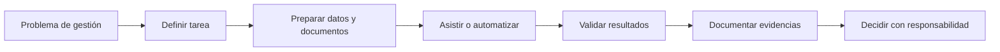
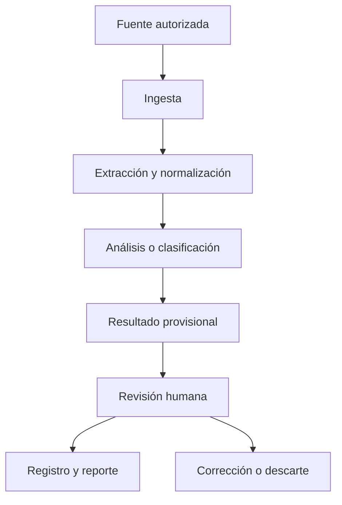
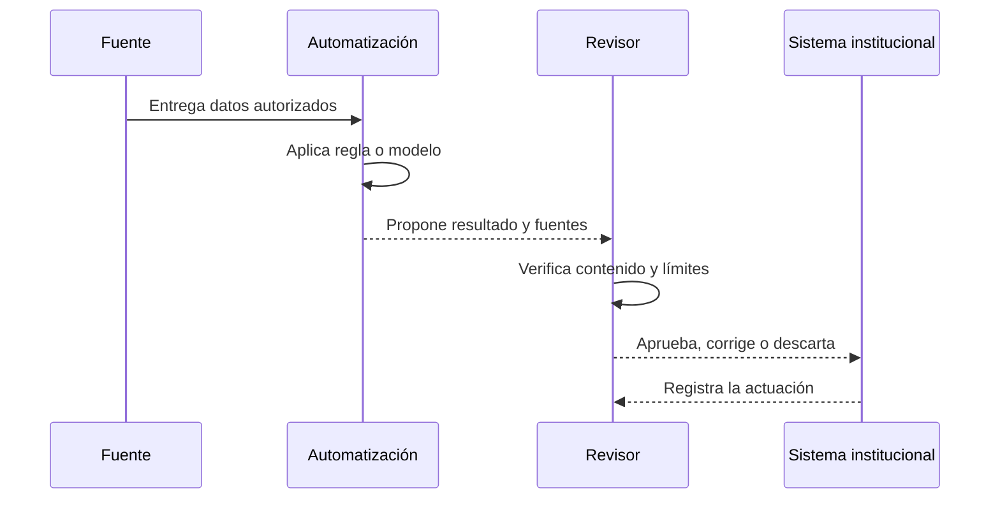
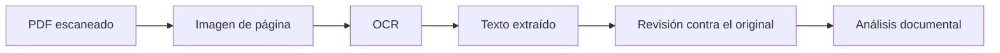
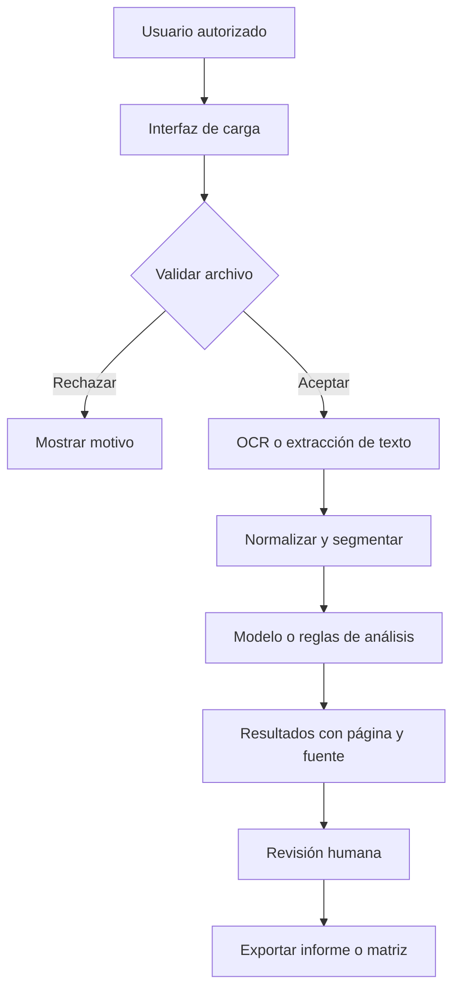
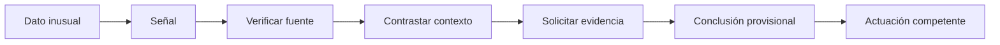
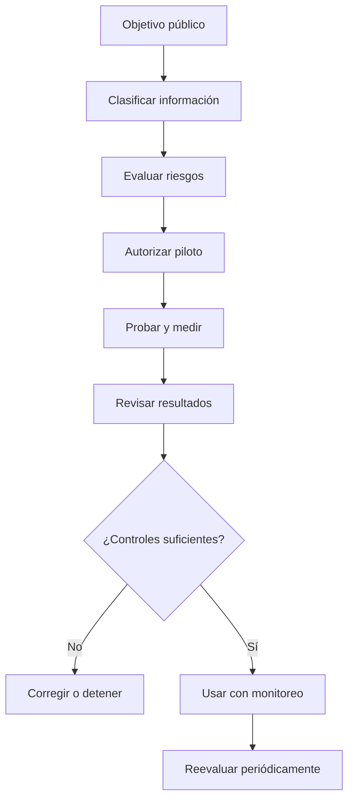

# Sesión 4. Inteligencia artificial aplicada a la gestión pública

**Curso:** Analítica de Datos e Inteligencia Artificial para la Gestión Pública  
**Dirigido a:** Servidores públicos de la Contraloría General de Boyacá

> **Idea central:** La inteligencia artificial puede ayudar a organizar, buscar, comparar y transformar información pública. Sin embargo, automatizar una tarea no significa delegar una responsabilidad, una alerta no equivale a un hallazgo y un prototipo que funciona en una demostración no es automáticamente un sistema institucional seguro.

---

## Propósitos de aprendizaje

Al finalizar la sesión, cada participante podrá:

1. Identificar tareas repetitivas de la gestión pública que pueden asistirse con IA.
2. Diseñar un flujo para analizar documentos y grandes volúmenes de información.
3. Distinguir automatización, asistencia, priorización y decisión institucional.
4. Reconocer riesgos de errores, alucinaciones, pérdida de contexto, acceso indebido y automatización excesiva.
5. Proponer indicadores y controles para evaluar una solución basada en IA.
6. Documentar un prototipo desarrollado con ChatGPT, Google AI Studio u otra herramienta.
7. Redactar informes y reportes que separen datos, inferencias, alertas y conclusiones verificadas.

## El recorrido de la sesión



La sesión se organiza en cinco usos principales:

| Uso | Pregunta orientadora | Producto posible |
|---|---|---|
| Automatización de tareas | ¿Qué actividad repetitiva consume tiempo sin requerir todavía una decisión? | Clasificación, extracción, resumen o aviso |
| Análisis documental | ¿Cómo encontrar información relevante en muchos documentos? | Matriz de evidencias, búsqueda o comparación |
| Riesgos y anomalías | ¿Qué señales merecen una revisión prioritaria? | Lista de alertas explicadas |
| Informes y reportes | ¿Cómo transformar resultados en comunicación útil? | Borrador trazable y revisable |
| Casos públicos | ¿Dónde aporta valor sin reemplazar la competencia institucional? | Prototipo con controles y límites |

---

# 1. De la tarea pública al caso de uso de IA

## 1.1. ¿Qué es un caso de uso?

Un caso de uso describe una necesidad concreta, las personas que participan, la información que se utiliza, la transformación esperada y el resultado que debe revisarse.

No basta con decir «usar IA en la entidad». Un caso de uso debe responder:

```text
¿Qué problema se quiere resolver?
¿Quién necesita el resultado?
¿Qué tarea se quiere asistir?
¿Qué información se utilizará?
¿Qué resultado se espera?
¿Qué error sería grave?
¿Quién revisa y aprueba el resultado?
¿Qué queda fuera del alcance?
```

## 1.2. La unidad mínima de diseño

Una forma práctica de formular un caso de uso es:

```text
Cuando [situación de trabajo],
el equipo necesita [tarea],
para producir [resultado],
usando [fuentes],
con [controles],
y la decisión final corresponde a [responsable].
```

### Ejemplo: clasificación inicial de comunicaciones

```text
Cuando llegan comunicaciones ciudadanas,
el equipo necesita agruparlas por tema y territorio,
para priorizar su lectura,
usando los documentos autorizados,
con anonimización, registro de fuentes y revisión humana,
y la respuesta institucional corresponde al equipo competente.
```

La IA puede apoyar la clasificación, pero no debe inventar hechos, decidir por sí sola la respuesta oficial ni convertir una categoría en una sanción.

## 1.3. Automatización, asistencia, priorización y decisión

Estos conceptos deben distinguirse:

| Nivel | Qué hace el sistema | Ejemplo | Riesgo principal |
|---|---|---|---|
| Automatización mecánica | Ejecuta reglas repetitivas y predefinidas. | Renombrar archivos o enviar un aviso por una condición explícita. | Regla equivocada o datos desactualizados. |
| Asistencia | Propone una transformación para que una persona la revise. | Resumir un acta o extraer fechas. | Aceptar el borrador sin comprobarlo. |
| Priorización | Ordena casos según criterios o señales. | Sugerir qué expedientes leer primero. | Confundir prioridad con responsabilidad o irregularidad. |
| Decisión institucional | Produce efectos jurídicos, fiscales, administrativos o presupuestales. | Imponer una consecuencia o cerrar una actuación. | Delegar indebidamente competencias y garantías. |

La mayor parte de los ejercicios de esta sesión se ubica en los tres primeros niveles. Una salida generada por IA no reemplaza la competencia, el procedimiento ni la responsabilidad de la entidad.

## 1.4. Mapa de una solución aplicada



En cada flecha debe existir una respuesta para estas preguntas:

```text
¿Qué entra?
¿Qué se transforma?
¿Qué modelo, regla o herramienta participa?
¿Qué evidencia se conserva?
¿Qué ocurre cuando el sistema se equivoca?
```

---

# 2. Automatización de tareas

## 2.1. ¿Qué tareas son buenas candidatas?

Una tarea puede ser una buena candidata cuando:

- se repite con frecuencia;
- tiene una entrada y una salida relativamente claras;
- su resultado puede ser revisado;
- los errores no producen por sí solos una decisión irreversible;
- existe una fuente autorizada y un responsable;
- el beneficio esperado supera el costo de configurar y controlar la solución.

Ejemplos:

```text
Clasificar comunicaciones por tema.
Extraer fechas, entidades y valores de documentos.
Convertir una tabla desordenada en una estructura revisable.
Comparar dos versiones de un informe.
Preparar un resumen ejecutivo con citas a la fuente.
Generar una lista de pendientes.
Recordar una revisión periódica.
```

## 2.2. ¿Qué tareas no deben automatizarse sin controles reforzados?

Requieren especial cuidado las tareas que:

- afectan derechos de personas;
- producen consecuencias jurídicas o fiscales;
- clasifican personas o entidades como riesgosas;
- trabajan con información reservada, sensible o credenciales;
- eliminan o modifican documentos originales;
- envían comunicaciones oficiales sin aprobación;
- ejecutan acciones externas sin autorización clara.

Una automatización puede preparar un borrador, pero debe existir una persona responsable de revisar el contenido, la fuente, el alcance y la acción que finalmente se realiza.

## 2.3. Diseño de una automatización



Una automatización responsable debe definir:

| Elemento | Pregunta |
|---|---|
| Disparador | ¿Qué evento inicia el flujo? |
| Entrada | ¿Qué datos o documentos puede usar? |
| Transformación | ¿Qué regla, prompt, modelo o código se ejecuta? |
| Salida | ¿Qué produce y en qué formato? |
| Revisión | ¿Quién verifica antes de usar? |
| Excepción | ¿Qué pasa si faltan datos o hay un error? |
| Registro | ¿Qué evidencia queda disponible? |
| Detención | ¿Cómo se pausa o cancela? |

## 2.4. ChatGPT para organizar proyectos

Un proyecto en ChatGPT puede funcionar como un espacio de trabajo para reunir conversaciones, archivos de referencia e instrucciones específicas. Es útil para mantener el contexto de una actividad prolongada, por ejemplo, una revisión documental, un plan de seguimiento o la preparación de informes.

### Buen uso de un proyecto

```text
Definir el objetivo del proyecto.
Incluir instrucciones de trabajo revisadas.
Separar fuentes oficiales de borradores.
Indicar el formato esperado de las respuestas.
Solicitar citas o referencias a los documentos.
Definir qué no debe concluir el modelo.
Revisar periódicamente los archivos y permisos.
```

### Ejemplo de instrucciones de proyecto

```text
Actúa como asistente de análisis documental para una revisión de contratación pública.

Usa únicamente los archivos y fuentes que se indiquen en cada consulta.
Separa hechos, citas, inferencias y preguntas pendientes.
No declares responsabilidad, irregularidad o daño fiscal sin evidencia suficiente.
Cuando no encuentres soporte, responde: "No está demostrado en las fuentes revisadas".
Indica el nombre del archivo y la página o sección cuando sea posible.
Entrega primero una síntesis y después una matriz de evidencias.
```

Las instrucciones ayudan a orientar el trabajo, pero no garantizan que el modelo siempre cumpla cada regla. La respuesta debe seguir siendo revisada.

## 2.5. Tareas programadas y monitoreo

Una tarea programada permite pedir a ChatGPT una acción puntual o recurrente, como un recordatorio, una actualización periódica o el monitoreo de una condición compatible con la cuenta y el espacio de trabajo.

Una tarea bien formulada contiene:

```text
Nombre de la tarea.
Fuente o condición que debe revisarse.
Actividad que debe realizarse.
Frecuencia o fecha.
Zona horaria.
Formato del resultado.
Condición para avisar.
Límite de la tarea.
```

### Ejemplo: seguimiento de una fuente pública

```text
Cada lunes a las 8:00 a. m., revisa la fuente pública autorizada indicada en esta tarea.
Resume únicamente cambios publicados desde la revisión anterior.
Incluye fecha, enlace, descripción del cambio y una pregunta de verificación.
No envíes comunicaciones externas ni concluyas que un cambio constituye una irregularidad.
Si no puedes acceder a la fuente, informa la limitación.
```

Las tareas programadas no deben tratarse como vigilancia infalible. Pueden depender de la cuenta, el plan, los permisos, las conexiones y la disponibilidad de la fuente. Un resultado completado tampoco demuestra por sí solo que cada acción o afirmación haya sido correcta.

> **Nota:** Si una tarea se crea dentro de un proyecto, no necesariamente puede consultar los archivos cargados en ese proyecto. Deben verificarse las capacidades y permisos efectivos antes de diseñar el flujo.

## 2.6. Laboratorio 1 — Del procedimiento repetitivo al flujo asistido

Elija una tarea real o ficticia y complete:

| Campo | Respuesta |
|---|---|
| Nombre de la tarea | |
| Problema que resuelve | |
| Entrada autorizada | |
| Transformación | |
| Resultado esperado | |
| Error más grave | |
| Persona revisora | |
| Evidencia que se conserva | |
| Acción que queda fuera del alcance | |

---

# 3. Análisis de documentos y grandes volúmenes de información

## 3.1. Leer no es lo mismo que procesar

Cuando se dice que una IA «lee» un documento pueden estar ocurriendo varias operaciones:

```text
Recibir el archivo.
Detectar el formato.
Extraer texto.
Reconocer tablas o imágenes.
Dividir el contenido.
Indexar fragmentos.
Recuperar partes relevantes.
Generar una respuesta.
```

Cada etapa puede introducir pérdida de información. Un PDF escaneado puede no tener una capa de texto; una tabla puede extraerse con columnas mezcladas; un documento extenso puede exceder la capacidad de contexto; y una respuesta puede citar un fragmento sin representar todo el expediente.

## 3.2. OCR: convertir imagen en texto procesable

El OCR —reconocimiento óptico de caracteres— convierte una imagen o página escaneada en una representación textual. No es una prueba de que el texto haya sido interpretado correctamente.



Errores frecuentes:

```text
0 / O confundidos.
1 / l / I confundidos.
Comas y puntos omitidos.
Firmas o sellos no reconocidos.
Tablas convertidas en texto desordenado.
Encabezados mezclados con el cuerpo.
Páginas rotadas o cortadas.
Notas manuscritas no interpretadas.
```

### Regla para documentos de control

El texto extraído sirve para buscar y organizar. Cuando una cifra, fecha, nombre o afirmación sea relevante, debe comprobarse contra la imagen o el documento original.

## 3.3. Análisis de grandes volúmenes

Analizar muchos documentos no significa pedir un único resumen general. Conviene dividir el trabajo en etapas:

1. Inventariar archivos y versiones.
2. Clasificar por tipo, entidad, fecha o expediente.
3. Extraer campos estructurados.
4. Buscar términos y relaciones.
5. Comparar documentos.
6. Construir una matriz de evidencias.
7. Revisar muestras y excepciones.
8. Elaborar el informe con trazabilidad.

### Matriz mínima de evidencias

| Documento | Página o sección | Hecho extraído | Cita o soporte | Confianza | Revisión |
|---|---|---|---|---|---|
| Acta 01 | p. 3 | Fecha de entrega | Texto visible | Pendiente | Revisar original |
| Informe 02 | p. 8 | Valor reportado | Tabla | Media | Comparar con registro |

La matriz evita que una afirmación importante quede separada de su fuente.

## 3.4. Google AI Studio para prototipos

Google AI Studio puede utilizarse para explorar modelos, construir prototipos y generar aplicaciones a partir de instrucciones. En su modo de construcción, puede producir una aplicación web con archivos de código, vista previa y componentes que luego deben ser revisados.

En un prototipo para documentos, la aplicación podría incluir:

```text
Carga controlada de archivos.
Validación de tipo y tamaño.
Extracción de texto u OCR.
Segmentación por páginas o secciones.
Búsqueda por palabras clave.
Preguntas sobre el contenido.
Extracción de campos.
Exportación de una matriz de resultados.
```

La herramienta de desarrollo no convierte automáticamente el prototipo en un sistema seguro. Antes de utilizar documentos reales deben revisarse:

- dónde se procesan los archivos;
- qué credenciales, claves o APIs utiliza la aplicación;
- si los datos se envían a un servicio externo;
- qué archivos temporales se conservan;
- quién puede acceder a la aplicación y a sus resultados;
- cómo se controla el uso de modelos y costos;
- cómo se corrigen los errores;
- qué pruebas se ejecutaron.

### Arquitectura conceptual de un prototipo OCR



La frase «hacer OCR con Google AI Studio» debe explicarse con precisión: el desarrollo puede integrar un flujo de extracción o reconocimiento, pero hay que comprobar qué componente realiza cada operación, cómo se validan los resultados y cuáles son las condiciones del servicio.

## 3.5. Prompt para un análisis documental verificable

```text
Analiza el documento delimitado entre INICIO y FIN.

Objetivo: extraer fechas, valores, entidades y obligaciones.

Reglas:
1. No inventes información que no aparezca en el documento.
2. Para cada dato, indica página o sección.
3. Si el texto es ilegible, informa "no verificable".
4. Separa extracción literal de interpretación.
5. No concluyas incumplimiento o responsabilidad.

Entrega una tabla con estas columnas:
campo | valor extraído | página | cita breve | nivel de confianza | duda

INICIO
[documento]
FIN
```

## 3.6. Laboratorio 2 — Comparar OCR y original

Use un documento de práctica y registre:

```text
Número de páginas.
Páginas con texto seleccionable.
Páginas que requieren OCR.
Tres errores de extracción encontrados.
Una cifra verificada contra la imagen.
Un campo que no debe completarse por inferencia.
```

---

# 4. Identificación de riesgos y anomalías

## 4.1. Una señal no es un hallazgo

Una anomalía es una diferencia que merece atención. Puede surgir por error de digitación, cambio de procedimiento, dato incompleto, diferencia legítima o comportamiento que requiere investigación.



Nunca debe saltarse directamente de un valor atípico a una acusación.

## 4.2. Tipos de anomalías que pueden priorizarse

| Tipo | Ejemplo | Pregunta de control |
|---|---|---|
| Temporal | Fecha fuera del periodo esperado. | ¿La fecha está bien registrada y cuál es la fuente? |
| Numérica | Valor muy superior a los demás. | ¿La unidad y el denominador son comparables? |
| Documental | Falta un anexo o una firma. | ¿El documento no existe, no se cargó o no fue extraído? |
| Relacional | NIT o ID que no coincide entre tablas. | ¿La llave fue normalizada y la fuente es compatible? |
| Semántica | El texto describe algo distinto al campo. | ¿La categoría representa realmente el fenómeno? |
| Operativa | Muchos registros repetidos o cambios inesperados. | ¿Es un comportamiento legítimo o un problema de calidad? |

## 4.3. Puntajes y umbrales

Un puntaje de riesgo requiere documentación:

```text
¿Qué significa?
¿Cómo se calcula?
¿Qué variables utiliza?
¿Qué datos faltantes lo afectan?
¿Cómo se validó?
¿Qué falsos positivos produce?
¿Qué falsos negativos puede ocultar?
¿Qué acción permite y cuál no permite?
```

Un umbral no es una verdad natural. Es una decisión de diseño que debe justificarse, revisarse y monitorearse.

## 4.4. Sesgos y automatización excesiva

Una solución puede producir resultados desiguales si:

- solo analiza documentos digitalizados y excluye expedientes escaneados;
- recibe más información de entidades grandes que de entidades pequeñas;
- usa etiquetas históricas que ya contenían criterios inconsistentes;
- toma la ausencia de un documento como prueba de incumplimiento;
- prioriza casos que se parecen a ejemplos anteriores sin revisar el contexto;
- presenta una probabilidad con apariencia de certeza.

La revisión debe comparar resultados entre entidades, municipios, modalidades, periodos y tipos de documento cuando sea pertinente.

## 4.5. Laboratorio 3 — Diseñar una alerta explicable

Para una alerta ficticia, complete:

| Campo | Respuesta |
|---|---|
| Señal observada | |
| Fuente | |
| Regla o modelo | |
| Contexto que falta | |
| Evidencia necesaria | |
| Posible falso positivo | |
| Posible falso negativo | |
| Responsable de revisar | |
| Redacción prudente | |

Una redacción prudente podría ser:

```text
El registro presenta una señal que justifica revisión adicional.
La señal no demuestra por sí sola incumplimiento, daño fiscal o responsabilidad.
Se requiere contrastar [fuente o documento] antes de formular una conclusión.
```

---

# 5. Elaboración de informes y reportes con IA

## 5.1. La IA como asistente de redacción

La IA puede ayudar a transformar insumos en borradores:

```text
Notas → esquema
Tabla → resumen
Expediente → matriz de evidencias
Resultados → explicación para distintos públicos
Informe técnico → resumen ejecutivo
```

La herramienta no debe decidir qué hecho es verdadero únicamente por su fluidez. La redacción profesional exige volver a las fuentes.

## 5.2. Estructura de un reporte verificable

Un reporte de análisis asistido por IA puede incluir:

1. **Pregunta:** qué se buscó conocer.
2. **Alcance:** periodo, entidades, documentos y exclusiones.
3. **Fuentes:** enlaces, archivos, versiones y fecha de consulta.
4. **Método:** extracción, reglas, consultas, filtros y modelo utilizado.
5. **Resultados:** datos y citas que puedan comprobarse.
6. **Limitaciones:** datos faltantes, OCR, cobertura o incertidumbre.
7. **Alertas:** señales que requieren revisión, sin presentarlas como hechos probados.
8. **Conclusión:** qué puede sostenerse y qué sigue pendiente.
9. **Recomendación:** acción concreta dentro de la competencia institucional.

## 5.3. Prompt para un informe

```text
Con base únicamente en la matriz de evidencias, redacta un borrador de informe.

Estructura:
1. Pregunta de análisis.
2. Alcance y fuentes.
3. Método.
4. Resultados comprobables.
5. Señales para revisar.
6. Limitaciones.
7. Preguntas pendientes.

Reglas:
- No inventes hechos ni citas.
- No conviertas una señal en una conclusión.
- Conserva las referencias de documento y página.
- Si una afirmación no tiene soporte, márcala como pendiente.
- Usa lenguaje claro, neutral y verificable.
```

## 5.4. Diferencia entre dato, hallazgo, hipótesis y acción

| Elemento | Qué es | Ejemplo |
|---|---|---|
| Dato | Valor o contenido observado en una fuente. | El contrato registra un valor de $500 millones. |
| Hallazgo analítico | Relación o patrón que aparece tras un método explicado. | El valor concentra el 60 % del total del subconjunto. |
| Hipótesis | Explicación posible aún no verificada. | La diferencia puede deberse a una modificación posterior. |
| Acción | Paso institucional para comprobar, corregir o decidir. | Solicitar el documento y contrastar la fecha. |

La IA puede ayudar a redactar cada elemento, pero no debe borrar las diferencias entre ellos.

## 5.5. Reportes para distintos públicos

Un mismo análisis puede necesitar varias salidas:

```text
Matriz técnica para el equipo auditor.
Resumen ejecutivo para la dirección.
Respuesta clara para una solicitud ciudadana.
Ficha de seguimiento con responsables y fechas.
Anexo metodológico para trazabilidad.
```

Cambiar el formato no debe cambiar los hechos. Si un resumen omite una limitación importante, puede generar una interpretación equivocada.

## 5.6. Laboratorio 4 — Del análisis al informe

A partir de una matriz pequeña:

1. Solicite a la IA una síntesis de cinco líneas.
2. Pida una tabla de evidencias.
3. Solicite un resumen ejecutivo.
4. Compare cada afirmación con la fuente original.
5. Marque inventos, omisiones, cambios de tono y conclusiones excesivas.
6. Reescriba el informe con las correcciones.

---

# 6. Casos de uso en entidades públicas

## 6.1. Contratación pública

Posibles usos:

```text
Clasificar procesos por modalidad.
Extraer fechas, valores y entidades.
Comparar versiones de estudios previos.
Buscar obligaciones y entregables.
Priorizar expedientes con señales documentales.
Preparar una matriz de seguimiento.
```

Controles:

```text
No declarar irregularidad solo por un puntaje.
Verificar la fuente oficial.
Separar procesos de contratos.
Registrar el periodo y los filtros.
Revisar documentos originales.
```

## 6.2. Control de obras y proyectos

Posibles usos:

```text
Comparar cronogramas y actas.
Extraer avances físicos y financieros.
Localizar obligaciones repetidas.
Identificar fechas que requieren contraste.
Organizar fotografías y comunicaciones.
```

La IA no determina por sí sola si una obra está bien ejecutada. La evidencia debe incluir el contexto técnico, la visita, las actas, los contratos y las competencias de quienes evalúan.

## 6.3. Atención a la ciudadanía

Posibles usos:

```text
Clasificar solicitudes.
Detectar temas recurrentes.
Proponer respuestas de primer borrador.
Identificar solicitudes que requieren traslado.
Medir tiempos de atención.
```

Debe protegerse la información personal. La clasificación automática no debe negar derechos, ocultar una petición ni reemplazar la respuesta de la autoridad competente.

## 6.4. Presupuesto y ejecución de recursos

Posibles usos:

```text
Comparar apropiación, compromisos, obligaciones y pagos.
Detectar cambios entre reportes.
Preparar tablas de seguimiento.
Explicar variaciones a partir de fuentes.
```

Los conceptos deben conservar su definición institucional. No se debe usar «ejecutado», «comprometido», «obligado» y «pagado» como si fueran equivalentes.

## 6.5. Gestión documental

Posibles usos:

```text
Inventariar expedientes.
Extraer metadatos.
Detectar documentos duplicados.
Encontrar anexos faltantes.
Convertir documentos escaneados en texto buscable.
Construir índices y matrices.
```

Un documento que no aparece en la extracción no necesariamente está ausente. Puede estar escaneado, protegido, mal formado o fuera del conjunto procesado.

## 6.6. Tabla de decisión

| Caso | IA puede asistir en | No debe hacer sin controles |
|---|---|---|
| Contratación | Extraer campos y comparar expedientes. | Declarar responsabilidad o daño. |
| Obras | Organizar actas y cronogramas. | Certificar avance físico por una fotografía. |
| Ciudadanía | Clasificar temas y preparar borradores. | Decidir si una persona tiene derecho a respuesta. |
| Presupuesto | Calcular y explicar variaciones. | Cambiar definiciones contables. |
| Archivos | OCR, búsqueda e inventario. | Eliminar originales o alterar evidencia. |

---

# 7. Gobernanza de una solución de IA

## 7.1. Gobernar es hacer responsable el uso

La gobernanza de IA reúne reglas, roles, controles, documentación, seguimiento y mecanismos de corrección. No se limita a escoger un modelo.



## 7.2. Roles mínimos

```text
Dueño del problema: define la necesidad pública.
Responsable de datos: conoce la fuente, calidad y permisos.
Responsable técnico: configura la aplicación o integración.
Revisor funcional: comprueba si el resultado sirve para la tarea.
Responsable jurídico o de privacidad: analiza obligaciones aplicables.
Responsable de aprobación: decide si el producto puede utilizarse.
```

Una sola persona puede cumplir varios roles en un piloto pequeño, pero las responsabilidades deben quedar explícitas.

## 7.3. Ficha de una solución

| Campo | Registro |
|---|---|
| Nombre | |
| Problema | |
| Usuarios autorizados | |
| Fuentes | |
| Datos personales o reservados | |
| Herramienta y modelo | |
| Proveedor o servicio externo | |
| Salida | |
| Riesgos | |
| Controles | |
| Revisión humana | |
| Fecha de evaluación | |
| Condición para detener | |

## 7.4. Indicadores de calidad

No basta con medir cuántas respuestas produce la herramienta. También pueden evaluarse:

```text
Exactitud de campos extraídos.
Porcentaje de citas correctas.
Cobertura de documentos procesados.
Tasa de falsos positivos.
Tasa de falsos negativos.
Tiempo ahorrado después de revisar.
Número de correcciones humanas.
Incidentes de seguridad o privacidad.
Casos en los que el sistema debe abstenerse.
```

## 7.5. Criterios de aceptación

Antes de usar una solución en una actividad real, definir:

```text
Qué debe hacer correctamente.
Qué no debe hacer.
Con qué documentos se probará.
Qué errores se toleran y cuáles no.
Quién revisará los resultados.
Cómo se registrará cada versión.
Cuándo se suspenderá el uso.
```

---

# 8. Caso integrador — Asistente documental para control fiscal

## Situación

Un equipo quiere desarrollar un prototipo que reciba expedientes de contratación, aplique OCR a páginas escaneadas, extraiga fechas y valores, busque obligaciones y prepare una matriz de señales para revisión.

## Preguntas de diseño

```text
¿Qué documentos están autorizados para el piloto?
¿Cómo se clasifican los datos personales?
¿Qué componente realiza el OCR?
¿Cómo se conserva el original?
¿Cómo se indica la página de cada extracción?
¿Qué ocurre si el OCR no reconoce una cifra?
¿Cómo se evita que el texto del documento dé instrucciones al modelo?
¿Qué salida debe revisar una persona?
¿Qué acciones están prohibidas para el prototipo?
```

## Producto del equipo

El equipo entrega:

1. Ficha del caso de uso.
2. Diagrama del flujo.
3. Matriz de riesgos y controles.
4. Prompt o especificación de la solución.
5. Ejemplo de entrada y salida.
6. Evidencias de validación.
7. Lista de límites y preguntas pendientes.

## Criterios de evaluación

| Criterio | Pregunta |
|---|---|
| Pertinencia | ¿La solución responde a un problema real y delimitado? |
| Trazabilidad | ¿Cada resultado puede relacionarse con su fuente? |
| Seguridad | ¿Se reducen accesos, exposición y pérdida de información? |
| Calidad | ¿Se midieron errores y casos de abstención? |
| Responsabilidad | ¿Está claro quién revisa y decide? |
| Viabilidad | ¿El prototipo puede mantenerse y corregirse? |

---

# 9. Lista de verificación

## Antes de usar una herramienta

- [ ] Definí el problema y la tarea exacta.
- [ ] Clasifiqué la información.
- [ ] Confirmé la fuente y los permisos.
- [ ] Identifiqué al responsable de revisión.
- [ ] Definí qué no puede concluir la herramienta.
- [ ] Registré la herramienta, el modelo y la versión disponible.
- [ ] Revisé si hay servicios externos, claves o costos.

## Durante el análisis

- [ ] Conservé los documentos originales.
- [ ] Verifiqué el OCR con muestras.
- [ ] Solicité citas, páginas o referencias.
- [ ] Separé datos, inferencias y preguntas pendientes.
- [ ] Revisé falsos positivos y falsos negativos.
- [ ] Registré errores y correcciones.

## Antes de publicar o decidir

- [ ] Una persona competente revisó el resultado.
- [ ] Las cifras coinciden con la fuente.
- [ ] Las limitaciones están explicadas.
- [ ] No se presenta una alerta como una conclusión.
- [ ] El informe no contiene datos innecesarios.
- [ ] Se conserva la trazabilidad del proceso.

---

# 10. Fuentes de consulta

Las herramientas cambian según la cuenta, el plan, el espacio de trabajo y la versión disponible. Antes de una práctica, revise la documentación y las políticas vigentes.

- [Projects en ChatGPT](https://help.openai.com/en/articles/10169521-using-projects-in-chatgpt)
- [Tareas programadas en ChatGPT](https://help.openai.com/en/articles/10291617-scheduled-tasks-in-chatgpt)
- [Construcción de aplicaciones en Google AI Studio](https://ai.google.dev/gemini-api/docs/aistudio-build-mode)
- [OWASP Top 10 para aplicaciones con LLM](https://genai.owasp.org/llmrisk/)
- [NIST AI Risk Management Framework](https://airc.nist.gov/airmf-resources/airmf/)

---

# Conclusión

La IA aplicada a la gestión pública tiene valor cuando reduce trabajo repetitivo, ayuda a encontrar información, permite comparar documentos y mejora la comunicación de resultados. Su utilidad depende de que el problema esté bien definido, los datos sean apropiados, las salidas puedan comprobarse y la responsabilidad humana permanezca visible.

La fórmula de trabajo es:

**PROBLEMA CLARO + DATOS AUTORIZADOS + HERRAMIENTA ADECUADA + RESULTADO TRAZABLE + REVISIÓN HUMANA + RESPONSABILIDAD INSTITUCIONAL.**

Un prototipo puede ser una excelente forma de aprender y descubrir oportunidades. Antes de convertirlo en una práctica institucional, debe pasar por evaluación de seguridad, privacidad, calidad, accesibilidad, costos, mantenimiento y competencias legales.
