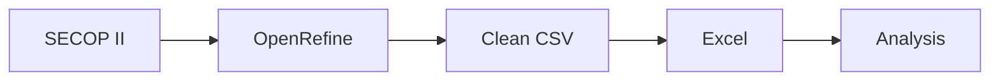

# Session 2 — Data analysis for public management

**Course:** Data Analytics and Artificial Intelligence for Public Management  
**Institution:** Contraloría General de Boyacá

## Purpose

This session uses real public data to move from a downloaded dataset to information that can answer public-management questions.

The path is:


Two tools will be used mainly:

- **OpenRefine**, to explore, clean, standardize, and join datasets.
- **Excel**, for lookups, conditional calculations, pivot tables, pivot charts, and a simple dashboard.

The main case uses **SECOP II** data, with emphasis on records from Boyacá.

## Main case study

### SECOP II — Procurement processes

[SECOP II — Procurement processes](https://www.datos.gov.co/Gastos-Gubernamentales/SECOP-II-Procesos-de-Contrataci-n/p6dx-8zbt)

Dataset identifier:

```text
p6dx-8zbt
```

The dataset includes variables such as:

```text
Entity
Entity tax ID
Entity department
Entity city
Process ID
Procedure name
Procedure description
Procurement method
Publication date
Base price
Awarded
Supplier
Awarded value
```

For practice, use:

```text
Entity department = Boyacá
```

and a closed period, for example:

```text
2025
```

> [!IMPORTANT]
> The national dataset contains millions of records. Before working in Excel, filter the data or use the subset prepared for the course.

### OpenRefine support resource

[OpenRefine: from an unclean dataset to trustworthy data](https://shocking-millennium-aa3.notion.site/OpenRefine-del-dataset-sin-limpiar-a-datos-confiables-3f7b5cde3be0818e8eacf1f6251cf7b7)

[Official OpenRefine manual](https://openrefine.org/docs.html)

## Complementary case — COVID-19 in Colombia

To practice time trends and work with a large dataset, use:

[Positive COVID-19 cases in Colombia](https://www.datos.gov.co/Salud-y-Protecci-n-Social/Casos-positivos-de-COVID-19-en-Colombia-/gt2j-8ykr/about_data)

Identifier:

```text
gt2j-8ykr
```

The dataset contains variables such as:

```text
Report date
Case ID
Notification date
Department
Municipality
Age
Sex
Transmission type
Status
Symptom onset date
Diagnosis date
Recovery date
```

[Download the complete CSV dataset](https://www.datos.gov.co/api/views/gt2j-8ykr/rows.csv?accessType=DOWNLOAD)

> [!CAUTION]
> The complete file exceeds the row limit of an Excel worksheet. In Excel, use a sample or a filtered subset.

# Exploratory data analysis

## What is exploratory analysis?

**Exploratory data analysis (EDA)** is the initial process of getting to know a dataset before drawing conclusions.

It helps us understand:

```text
what the dataset contains,
how it is structured,
which values appear,
what information is missing,
how the data is distributed,
which behaviors deserve attention.
```

## First questions

When receiving a dataset, ask:

```text
How many rows does it have?
How many columns?
What does each row represent?
What does each column represent?
Which variables are numeric?
Which variables are categorical?
Which variables are dates?
Which values are missing?
Are there duplicates?
Which categories appear?
What are the minimum and maximum values?
Are there unusual values?
```

## Unit of observation

Before analyzing, identify what one row represents.

In SECOP II — Procurement processes:

```text
One row = one procurement process
```

Therefore:

```text
Number of rows
```

does not necessarily mean:

```text
Number of contracts
```

## Categorical variables

Examples:

```text
Department
Municipality
Procurement method
Phase
Status
Entity
Supplier
```

Questions:

```text
Which methods appear?
Which one appears most often?
How many different entities are there?
Which municipalities appear?
Are values such as "Not defined" present?
```

## Numeric variables

Examples:

```text
Base price
Awarded value
Duration
Number of responses
```

Questions:

```text
What is the minimum?
What is the maximum?
What is the average?
Are there extremely high values?
Are there zeros?
Are there negative values?
```

## Date variables

Examples:

```text
Publication date
Last publication date
Award date
```

They help answer:

```text
How many processes were published each month?
Is there a month with more activity?
How does the behavior change during the year?
```

## Initial exploration with OpenRefine

### Create the project

```text
OpenRefine
↓
Create Project
↓
This Computer
↓
Select CSV
↓
Next
↓
Create Project
```

OpenRefine works on a copy inside the project and does not directly modify the original file.

### Text facet

```text
Column
↓
Facet
↓
Text facet
```

Useful for:

```text
Procurement method
Entity city
Entity department
Phase
Supplier
```

It reveals categories, frequencies, variants, and uncommon values.

### Numeric facet

```text
Column
↓
Facet
↓
Numeric facet
```

Useful for:

```text
Base price
Awarded value
```

It helps inspect minimums, maximums, distributions, and non-numeric values.

### Blank facet

```text
Column
↓
Facet
↓
Customized facets
↓
Facet by blank
```

```text
true  → blank
false → contains information
```

### Duplicate facet

If a variable should act as an identifier:

```text
Process ID
```

review it through:

```text
Column
↓
Facet
↓
Customized facets
↓
Duplicates facet
```

> [!IMPORTANT]
> Finding a repeated identifier does not mean that it should be deleted automatically. First understand why it is repeated.

## Workshop — SECOP II exploration

Record:

```text
Number of rows:
Number of columns:
Unit of observation:
```

Then answer:

```text
How many different procurement methods appear?
How many different entities appear?
How many municipalities appear?
Which columns contain blank values?
Which columns contain "Not defined"?
Minimum base price:
Maximum base price:
Are there zeros?
Minimum date:
Maximum date:
Do all records belong to the expected period?
```

# Identifying patterns, trends, and anomalies

## Pattern

A pattern is a behavior that appears repeatedly.

Examples:

```text
A frequently used procurement method.
A supplier that appears repeatedly.
An entity with steady procurement activity.
Processes concentrated in particular months.
```

## Trend

A trend describes behavior over time.

```text
January     120 processes
February    135 processes
March       160 processes
April       190 processes
```

Trends usually require:

```text
date + count
```

or:

```text
date + value
```

## Anomaly

An anomaly is a data point or behavior that differs from the rest.

Examples:

```text
A process with a value far above the others.
A date outside the expected period.
A record without a municipality.
A supplier with an unusually high number of processes.
A category that appears only once.
```

> [!IMPORTANT]
> An anomaly is a **signal to review**, not proof of wrongdoing.


# Data cleaning with OpenRefine


## Unnecessary spaces

```text
Tunja
Tunja 
 Tunja
```

Path:

```text
Edit cells
↓
Common transforms
↓
Trim leading and trailing whitespace
```

## Repeated spaces

```text
MUNICIPAL  MAYOR'S OFFICE
```

Path:

```text
Edit cells
↓
Common transforms
↓
Collapse consecutive whitespace
```

## Uppercase and lowercase

```text
BOYACA
Boyaca
boyaca
```

Options:

```text
To uppercase
To lowercase
To titlecase
```

## Clustering

Clustering can locate variants such as:

```text
MUNICIPAL MAYOR'S OFFICE OF TUNJA
MUNICIPAL MAYOR’S OFFICE OF TUNJA
MUNICIPAL  MAYOR'S OFFICE OF TUNJA
```

Path:

```text
Text facet
↓
Cluster
```

Start with:

```text
Key collision
→ fingerprint
```

> [!CAUTION]
> OpenRefine proposes groups. A person must review the decision to merge them.

## Type conversion

```text
"350000000"
```

may need to be converted to a number.

```text
Edit cells
↓
Common transforms
↓
To number
```

Dates can also be transformed with:

```text
To date
```

Always check how many values were converted successfully.

## Missing data

Possible values include:

```text
blank
Not defined
Not applicable
NULL
0
```

They do not necessarily mean the same thing. Before replacing a value, ask:

```text
Is it truly missing?
Does it not apply?
Did the source fail to report it?
Is it a valid value?
```

## Duplicates

Review duplicates using an appropriate key.

Example:

```text
Process ID
```

Do not delete rows only because entity, supplier, and value are equal.

## Workshop — Cleaning

- [ ] Review leading and trailing spaces.
- [ ] Normalize repeated spaces.
- [ ] Review categories with Text Facet.
- [ ] Use clustering on a text variable.
- [ ] Identify blank cells.
- [ ] Review data types.
- [ ] Review possible duplicates by identifier.
- [ ] Check dates.
- [ ] Keep a record of transformations.

## History

OpenRefine records operations in:

```text
Undo / Redo
```

This makes it possible to review, undo, and reuse transformations.

# Joining and checking databases

## What does joining databases mean?

Joining data means relating two tables through a common field.

### Table A — Processes

| Supplier tax ID | Process | Value |
|---|---|---:|
| 800123456 | P-001 | 45000000 |

### Table B — Suppliers

| Tax ID | Name | Department |
|---|---|---|
| 800123456 | Constructor XYZ | Boyacá |

Key:

```text
Tax ID
```

Result:

| Tax ID | Process | Value | Name | Department |
|---|---|---:|---|---|
| 800123456 | P-001 | 45000000 | Constructor XYZ | Boyacá |

## Possible keys

```text
Tax ID
DIVIPOLA code
Process ID
Project code
Entity code
```

A good key must be stable, consistent, and comparable across datasets.

## Joining with OpenRefine

OpenRefine can query another project with:

```text
cross()
```

Workflow:

```text
Import dataset A
↓
Import dataset B
↓
Identify the key
↓
Clean the key in both datasets
↓
Add a column from the related project
```

Conceptual example:

```text
cell.cross("Suppliers","Tax ID").cells["Name"].value[0]
```

Before joining, ask:

```text
Is the tax ID text in both datasets?
Does one dataset contain hyphens and the other not?
Are there spaces?
Are there blank values?
Is the key repeated?
Can there be multiple matches?
```

## No match

A non-match can mean:

- a formatting problem;
- missing data;
- an incomplete dataset;
- a record not included in the second source;
- an incorrect key.

Do not automatically assume that a non-match is an error.

# From OpenRefine to Excel

When the dataset is sufficiently clean:

```text
Export
↓
Comma-separated value (.csv)
```

Example:

```text
secop_boyaca_2025_clean.csv
```



# Lookup functions in Excel

Lookup functions bring information from another table using a common key.

## VLOOKUP

```excel
=VLOOKUP(lookup_value; table_array; col_index_num; FALSE)
```

Example:

```excel
=VLOOKUP(B2; Suppliers!$A$2:$C$500; 2; FALSE)
```

Characteristics:

- vertical lookup;
- the key must be in the first column of the range;
- exact matching is recommended for identifiers;
- if duplicates exist, it returns the first match.

## HLOOKUP

```excel
=HLOOKUP(lookup_value; table_array; row_index_num; FALSE)
```

It is useful when information is arranged horizontally.

## XLOOKUP

```excel
=XLOOKUP(lookup_value; lookup_array; return_array; "Not registered")
```

Advantages:

- searches in any direction;
- does not require counting columns;
- lets you define the result when no match is found;
- can return data from columns on either side of the key.

| Function | Direction | Use |
|---|---|---|
| VLOOKUP | Vertical | Compatible with many versions |
| HLOOKUP | Horizontal | Occasional use |
| XLOOKUP | Any direction | Modern, flexible alternative |

# Conditional functions

## COUNTIF

```excel
=COUNTIF(range; criteria)
```

Example:

```excel
=COUNTIF(B:B; "Small-value procurement")
```

## SUMIF

```excel
=SUMIF(criteria_range; criteria; sum_range)
```

Example:

```excel
=SUMIF(B:B; "Small-value procurement"; F:F)
```

## COUNTIFS and SUMIFS

```excel
=COUNTIFS(range1; criteria1; range2; criteria2)
```

Conceptual example:

```text
Method = Small-value procurement
AND
Base price > 50 million pesos
```

```excel
=SUMIFS(sum_range; range1; criteria1; range2; criteria2)
```

## IF and IFERROR

```excel
=IF(F2>500000000;"High";IF(F2>100000000;"Medium";"Low"))
```

The ranges above are a teaching classification, not an official risk scale.

```excel
=IFERROR(VLOOKUP(A2;Suppliers!A:B;2;FALSE);"Not registered")
```

## AND / OR

```excel
=IF(AND(F2>50000000;B2="Direct procurement");"Review";"")
```

`Review` is a signal for observation, not a conclusion of wrongdoing.

# Workshop — Procurement statistics

Build:

| Method | Number of processes | Total value | % of total |
|---|---:|---:|---:|
| | | | |
| | | | |
| | | | |

Use:

```text
COUNTIF
SUMIF
COUNTIFS
SUMIFS
```

# Pivot tables

## What are they?

A pivot table reorganizes a flat dataset to answer questions without writing a separate formula for every category.

Data:

| Entity | Method | Supplier | Value |
|---|---|---|---:|
| Entity A | Small-value procurement | Supplier X | 45000000 |
| Entity A | Direct procurement | Supplier Y | 30000000 |
| Entity B | Direct procurement | Supplier Z | 120000000 |

Summary:

| Entity | Direct | Small-value | Total |
|---|---:|---:|---:|
| Entity A | 30000000 | 45000000 | 75000000 |
| Entity B | 120000000 | 0 | 120000000 |

## Prepare the data

The dataset should have:

- headers;
- one row per record;
- no completely blank rows;
- no merged cells.

Recommended:

```text
Ctrl + T
```

## Insert a pivot table

```text
Select a cell
↓
Insert
↓
PivotTable
↓
New worksheet
```

Areas:

```text
ROWS
COLUMNS
VALUES
FILTERS
```

Example:

```text
ROWS    → Method
VALUES  → Count of Process ID
VALUES  → Sum of Base price
FILTERS → Entity
```

# Questions with pivot tables

## Processes by method

```text
Row    → Method
Value  → Count of ID
```

## Value by method

```text
Row    → Method
Value  → Sum of Base price
```

## Distribution by month

```text
Row      → Publication date
Group by → Month
Value    → Count of processes
```

## Suppliers with the highest value

```text
Row    → Supplier
Value  → Sum
Filter → Top 10
```

## Percentage share

```text
Show values as
↓
% of grand total
```

# Grouping and slicers

Dates can be grouped by:

```text
Month
Quarter
Year
```

Numeric work ranges can also be created.

**Slicers** provide visual filters:

```text
Insert
↓
Slicer
```

Examples:

```text
Entity
Method
Year
Municipality
```

# Workshop — Multidimensional analysis

Build pivot tables to answer:

1. How many processes exist by method?
2. What total value does each method concentrate?
3. How are processes distributed by month?
4. Which suppliers have the highest accumulated value?
5. What percentage of total value does each entity or method represent?

> [!IMPORTANT]
> These questions describe and prioritize information. They do not, by themselves, constitute a fiscal conclusion.

# Pivot charts

A pivot chart is linked to a pivot table. When filters or slicers change, the chart updates.

```text
Select the pivot table
↓
Insert
↓
PivotChart
↓
Select a type
```

## Which chart should you use?

### Bars or columns

To compare categories:

```text
Value by method
Processes by entity
Top suppliers
```

### Line

For trends:

```text
Processes published per month
```

### Pie

For a small number of categories that make up a whole.

### Stacked bars

To compare composition.

### Scatter plot

To study the relationship between two numeric variables:

```text
Base price
vs.
Awarded value
```

# Design charts to communicate

Avoid:

```text
Chart 1
```

Prefer a title that communicates the observed result.

Every chart should state:

```text
Title
Unit
Period
Source
```

Example:

```text
Source: SECOP II
Coverage: Boyacá
Period: 2025
```

# Building indicators

An indicator should have:

```text
Name
Question
Formula
Source
Period
Unit
Interpretation
Limitation
```

## Share by procurement method

```text
Share = (Processes for one method / Total processes) × 100
```

## Share by value

```text
Value share = (Value for one method / Total value) × 100
```

## Completeness

```text
Completeness = (Records with an informed value / Total records) × 100
```

## Monthly variation

```text
Variation = ((Current month value - Previous month value) / Previous month value) × 100
```

# Workshop — Build an indicator

| Field | Answer |
|---|---|
| Name | |
| Question | |
| Numerator | |
| Denominator | |
| Formula | |
| Source | |
| Period | |
| Result | |
| Interpretation | |
| What does it not allow us to conclude? | |

# Applied cases: procurement, budget, and resource execution

## Procurement

Questions:

```text
How many processes are published by method?
Which entities concentrate the highest value?
How does the number of processes change by month?
Which suppliers appear most often?
Which records have values that require review?
```

Source:

[SECOP II — Procurement processes](https://www.datos.gov.co/Gastos-Gubernamentales/SECOP-II-Procesos-de-Contrataci-n/p6dx-8zbt)

## Budget

If a dataset contains:

```text
Initial appropriation
Final appropriation
Commitments
Obligations
Payments
```

the following can be built:

### Commitments compared with appropriation

```text
Commitments / Final appropriation × 100
```

### Obligations compared with commitments

```text
Obligations / Commitments × 100
```

### Payments compared with obligations

```text
Payments / Obligations × 100
```
